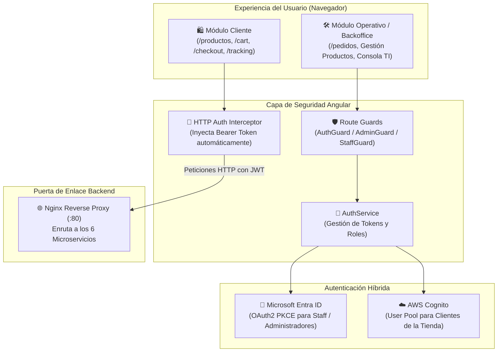
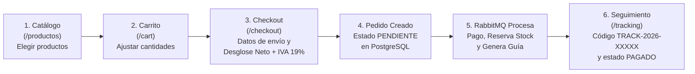

# Pedidos360 - Frontend (Angular 22)

Aplicación web frontend moderna desarrollada en **Angular 22**, con diseño responsivo, catálogo comercial interactivo, carrito de compras, proceso de pago con desglose tributario legal e integración de autenticación dual (**Microsoft Entra ID** y **AWS Cognito**).

---

## 1. Diagrama de Arquitectura del Frontend

El siguiente diagrama ilustra cómo está organizada la aplicación por dentro: las vistas públicas, las vistas de administración, los guardianes de seguridad y la comunicación hacia el backend y los proveedores de identidad:



---

## 2. Diagrama de Flujo del Proceso de Compra

Así recorre el cliente la plataforma desde que entra hasta que recibe su código de despacho:



---

## 3. Páginas y Módulos Principales

| Ruta | Nombre | ¿Quién la usa? | ¿Qué permite hacer? |
|---|---|---|---|
| **`/productos`** | Catálogo | Todos | Ver productos con fotos, stock y precios. Los administradores ven además botones para crear, editar o eliminar productos. |
| **`/cart`** | Carrito | Clientes | Modificar unidades, ver subtotales y proceder al pago. |
| **`/checkout`** | Pago | Clientes | Ingresar datos de envío y pagar. Calcula automáticamente el desglose tributario chileno ($\text{Neto} = \text{Total} / 1.19$ e $\text{IVA} = 19\%$). |
| **`/tracking`** | Seguimiento | Clientes / Todos | Consultar cualquier orden con una línea de tiempo visual y ver su código de despacho (`TRACK-2026-XXXXX`). |
| **`/pedidos`** | Gestión de Órdenes | Staff (Admin / Despacho) | Ver todos los pedidos de la tienda, cambiar estados y controlar envíos. |
| **`/login`** | Iniciar Sesión | Todos | Acceso con Microsoft Entra ID (Staff) o AWS Cognito (Clientes). |
| **`/home`** | Inicio | Todos | Mapa visual de la arquitectura y acceso a la consola de diagnóstico para auditorías. |

---

## 4. Ejecución en Entorno Local

1. **Instalar dependencias del proyecto:**
   ```bash
   pnpm install
   ```

2. **Ejecutar pruebas unitarias (Vitest + Angular):**
   ```bash
   pnpm test
   ```

3. **Iniciar el servidor de desarrollo:**
   ```bash
   pnpm start
   ```

4. **Abrir en tu navegador:**
   ```text
   http://localhost:4200
   ```

---

## 5. Despliegue en Producción (Docker en EC2)

Cuando el frontend corre dentro de Docker en la máquina virtual EC2:
- Utiliza **Nginx** como servidor web en el puerto `80`.
- No solo sirve los archivos estáticos de Angular, sino que actúa como **Reverse Proxy** hacia los microservicios (`/api/v1/...`), evitando problemas de CORS en producción.
- Lee las variables de AWS Cognito desde `/assets/runtime-config.json`, generado automáticamente al arrancar el contenedor sin necesidad de recompilar la aplicación.
